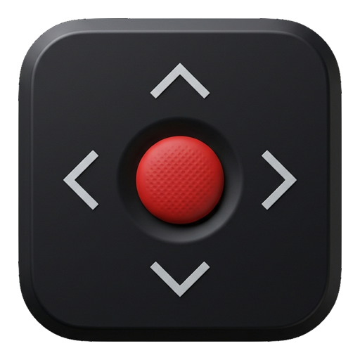
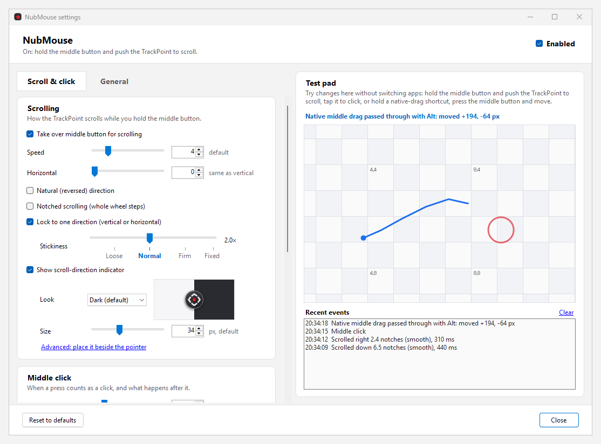

<p align="center">
  
</p>

<h1 align="center">NubMouse</h1>

<p align="center">
  ThinkPad &amp; pointing-stick middle-click, smooth scrolling, and 3D/CAD middle-drag for Windows.<br>
  <strong><a href="https://dstarikov.github.io/NubMouse/">Website &amp; Download</a></strong> ·
  <a href="https://github.com/dstarikov/NubMouse/releases/latest">Latest Release</a> ·
  <a href="docs/packaging.md">Packaging</a>
</p>

<p align="center">
  
</p>

| What you do with the middle button | What happens |
| --- | --- |
| Press and release it without touching the TrackPoint | A normal middle click (open link in new tab, close tab, …) |
| Hold it and push the TrackPoint | Scrolls vertically **and** horizontally; the pointer stays where it is |

It works the same in every app, because it sends ordinary mouse-wheel input instead of relying
on each app supporting the TrackPoint driver's own scrolling mode.

## Why

When the TrackPoint driver is in scrolling mode (the default), you lose standard middle-click —
you can't open links in background tabs, close tabs, or use middle-click actions in apps without
giving up scrolling. Even for scrolling itself, how well the driver works depends on the driver
version and the app: some apps don't scroll at all, and others only scroll in coarse steps.
NubMouse takes over the middle button in software instead, so you get a working middle click,
smooth scrolling, and optional native middle-drag everywhere.

### Why another tool?

On older ThinkPads I loved classic `TPMiddle` for giving me both middle-click and TrackPoint
scrolling, and it was one of the things I missed most on newer machines. Classic `TPMiddle` relied
on the older Synaptics driver's scrolling mode, so it didn't carry over cleanly to modern ELAN and
HID drivers. I tried existing alternatives like `LibreScroll`, `W10Wheel.NET`, and `X-Mouse Button
Control`, and while they're great tools in their own right, I wasn't able to get them configured
with the exact TrackPoint feel I wanted — so I built NubMouse as a focused utility around a
few priorities:

- **Zero-dependency, auditable builds (one small exe).** Everything compiles on a stock Windows 10/11
  machine using only the C# compiler and Windows metadata already built into Windows — no Visual
  Studio, .NET SDK, or third-party packages. For a mouse-hook utility, anyone can read the sources
  and build the exact binary themselves in a couple of seconds.
- **Live tuning with a test pad.** Speed, axis-lock stickiness, deadzone, click time limit and
  the rest apply as you change them in the settings window, right next to a test pad where you
  can feel each change (and see exactly what NubMouse sends) without switching apps or
  editing config files.
- **Native middle-drag for 3D modeling & CAD (including firmware-locked keyboards like TEX).**
  Holding a configurable shortcut key (or combo like `Ctrl+Alt`) while pressing the middle button
  passes a real middle-button drag straight through — so you can orbit and pan viewports in
  Blender, CAD, and design apps right from your TrackPoint without pausing NubMouse. Even on
  keyboards whose middle button scrolls in firmware and can't be rebound (like the **TEX Shura**
  `M_FN`), NubMouse unlocks middle-mouse dragging via either firmware-scroll conversion or smooth
  360° shortcut-plus-nub dragging. Per-device filtering also lets external USB/Bluetooth mice keep
  their native middle button untouched.
- **Adaptive axis locking.** Like the TrackPoint driver, each press locks to vertical or horizontal
  so slight drift doesn't wiggle pages sideways — while still letting you smoothly switch axes
  mid-press when you clearly push the other way (tunable from `loose` to `fixed`, or off for
  `diagonal`).
- **Everyday ThinkPad polish.** Instant event-driven autoscroll cancelling (dismisses browser and
  Office pan cursors after a lone middle click), live detection when the TrackPoint driver's own
  scrolling is still turned on, a click time limit so you can cancel a held press without sending a
  stray click, CLI remote control (`--toggle`, etc.), and an optional SHA-256 verified updater.
- **Low-latency hook in practice.** Even though it runs on .NET Framework 4.x, the `WH_MOUSE_LL`
  hook runs on its own high-priority thread with an allocation-free hot path and a separate
  coalescing output thread, so scrolling feels immediate.

## Install

1. Download `NubMouse.exe` from the [latest release](../../releases/latest) and run it.
2. Choose **Install**. By default it installs for your account only (no admin rights needed) and
   starts with Windows. Tick **Install for all users** to install into *Program Files* instead
   (this asks for administrator rights). Update checks stay off unless you tick them here or
   later in the tray menu. **Scroll in one direction at a time** (on by default) makes scrolling
   lock to vertical or horizontal like the driver's own scrolling; untick it to scroll
   diagonally too. **Just run it** runs the exe where it is, without installing anything.
3. **The TrackPoint driver's own middle-button scrolling has to be off**, so the driver sends a
   plain middle button. **With ELAN TrackPoint drivers (current ThinkPads) NubMouse does
   this for you:** while it's on, it sets the driver's **Middle Button Action** to "Middle
   Click", and when you pause or exit it, it puts "Scrolling" back, so the driver's own
   scrolling works while NubMouse is off. Both are in the tray menu under **TrackPoint
   driver ▸**: untick **Back to Scrolling when paused or closed** to keep a plain middle click
   while paused, or **Set it to Middle Click while NubMouse is on** to leave the driver
   setting alone. Uninstalling puts back a Scrolling setting it switched from.

   With other drivers, or if switching fails, set it yourself: **TrackPoint driver ▸ Open
   TrackPoint driver settings…** opens the driver's **TrackPoint** settings app (the same one as
   *Settings → Bluetooth & devices → Mouse → TrackPoint settings*); older drivers without that
   app get *Mouse Properties*, where they add a TrackPoint tab. Set **Middle Button Action** to
   "Middle Click", or turn scrolling off. If the driver is still scrolling while NubMouse
   is on, the tray icon gets an amber **!** badge, the menu shows **TrackPoint driver is still
   scrolling**, and a notification stays in the Windows notification centre until you clear it
   there (closing just the popup keeps it). Its **Set it now** button (ELAN) switches the
   setting, and **Open TrackPoint settings** opens the settings app. All of it clears as soon as
   the setting is switched, and the notification is also removed when NubMouse pauses or
   exits. With ELAN drivers it reads the saved setting, so it knows right away; with others it
   notices the driver's own scroll events while the button is held.

Requirements: Windows 10 or 11. It uses the .NET Framework 4.x that is built into Windows, so
nothing else needs installing.

> The exe is not code-signed, so Windows SmartScreen may warn the first time you run it
> (*More info → Run anyway*). Each release lists SHA-256 checksums, and you can always
> [build it yourself](#build-from-source).

**Privacy.** NubMouse never installs a keyboard hook and never logs keys or window titles. It
watches mouse input, and only checks `GetAsyncKeyState` for the specific native-drag shortcut
key(s) you configure (and briefly while recording a custom shortcut in Settings). It collects
nothing, and makes no network requests unless you turn on update checks, which only contact GitHub
(to read the latest release and download it).

### Updating

Both automatic options are **off by default**; turn them on in the install dialog or the tray
menu:

- **Check for updates automatically**: once a day, look for a new GitHub release and show a
  notification when there is one. Clicking it updates.
- **Install updates automatically**: install a found update straight away, without asking.
  Only for per-user installs (or an all-users install running as administrator), because
  otherwise updating needs a UAC prompt, which shouldn't appear out of nowhere.

An update downloads the new exe, checks it against the release's `SHA256SUMS.txt`, installs it
over the old one and restarts. **Check for updates now** works whatever the settings, and you can
always just download a newer exe and run it: it offers to update the installed copy. While the
tray icon is hidden, update notifications aren't shown.

### Uninstalling

*Settings → Apps → Installed apps → NubMouse → Uninstall*, or run
`NubMouse.exe --uninstall`. This removes the program, its Start menu shortcut, its
startup entry and its settings.

## Supported models

The scrolling and middle click work through a standard Windows mouse hook, so they don't depend
on the laptop model or the TrackPoint driver. What changes between models is the driver, which
decides whether NubMouse can switch the driver's **Middle Button Action** for you:

| Driver | Typical ThinkPads | Middle Button Action |
| --- | --- | --- |
| **ELAN** (TrackPoint shows up as an *ELAN TrackPoint* / *TrackPoint Component* device) | Most models from about 2022 on: X1 Carbon Gen 10+, X1 Yoga Gen 7+, T14 / T14s / T16 Gen 3+, P1, P14s, P16s, P16, X13 Gen 3+, and current E and L series | Switched automatically |
| **Synaptics** | Most models from about 2014 to 2021 | Set it to "Middle Click" yourself, once (step 3 of [Install](#install)) |

Lenovo didn't move every model to ELAN at the same time, so a few older models use ELAN and a
few newer ones still use Synaptics. To check yours, look in *Device Manager → Mice and other
pointing devices* or at the name of Lenovo's driver download for it (*ELAN UltraNav* vs.
*Synaptics*).

**Tested on:** ThinkPad P16 Gen 3 (2025, ELAN driver).

External TrackPoint keyboards such as the *ThinkPad TrackPoint Keyboard II* handle the middle
button in their own firmware and haven't been tested.

### Compatibility reports

Reports from other models help fill in this list, whether it works or not. Please post yours in
the [compatibility reports discussion](../../discussions) with:

- your ThinkPad model (for example *T14 Gen 4*),
- which TrackPoint driver it uses (ELAN or Synaptics) and its version,
- what works and what doesn't: middle click, scrolling, and whether the driver setting was
  switched automatically.

If your model is already listed there, add to that thread instead of starting a new one.
Requests for other models, devices or drivers are welcome in [Discussions](../../discussions)
too. For a bug, [open an issue](../../issues/new) and attach a `debug` log (see
[Troubleshooting](#troubleshooting)).

## The tray icon

The icon is a key cap with a TrackPoint dot: **red** while active, **grey** while paused.

- **Left-click** the icon to pause / resume. Paused means "normal mode": the hook is removed and
  the middle button behaves exactly as your driver sends it.
- **Right-click** for the menu: **Enabled**, **Settings and test pad…**, and quick toggles for
  **Natural (reversed) direction**, **Lock to one direction** and **Show scroll-direction
  indicator**, plus:
  - **Devices ▸** choose **All pointing devices** (default) or tick specific devices (e.g. only
    your TrackPoint, leaving external USB/Bluetooth mice untouched).
  - **TrackPoint driver ▸** (ELAN) set it to Middle Click while NubMouse is on, back to
    Scrolling when paused or closed, and **Open TrackPoint driver settings…**
  - **Startup ▸** **Start with Windows**, **Run as administrator**, **Hide tray icon**.
  - **Updates ▸** automatic checks, automatic installs, check now.
  - Help and Exit.

### Settings window

**Settings and test pad…** in the tray menu (or `--settings`) opens a window with every setting,
next to a test pad. Changes apply as you make them, and number boxes take values past the
sliders' ends (e.g. speed up to 100). It has two tabs.

**Scroll & click** — everything you tune by feel:

- **Scrolling:** vertical and horizontal speed, natural direction, notched scrolling, **Lock to
  one direction** and its **Stickiness** (a slider from 1.2× to 4.0× plus Fixed, with the Loose,
  Normal, Firm and Fixed presets marked under it; click a name to jump to it), and the
  **scroll-direction indicator**: while scrolling, the pointer turns into a small direction
  indicator. Pick its look (Dark, Light, Minimal or TrackPoint) and size (16 to 64 px) with a
  live preview; placing it beside the pointer instead is under **Advanced**.
- **Middle click:** deadzone, click time limit, and autoscroll cancelling.
- **Native drag (for 3D modeling apps):** Blender, CAD and other 3D apps rotate and pan by
  dragging with the middle button. Hold a shortcut as you press the middle button to give the
  app that drag instead of scrolling. Tick Alt, Ctrl or Shift, or record any key or combination
  (e.g. Space, Ctrl+Shift). Several shortcuts can be on at once, and any of them works. A normal
  key such as Space is also typed into the app.
- **Test pad** (beside both tabs): scroll, middle-click and native-drag on it to see exactly what NubMouse
  sends — wheel events and units, clicks, presses that sent no click and why, and passed-through
  drags — without switching to another app.

**General** — set once and leave:

- **Devices:** all pointing devices (default), or only the ticked ones, e.g. just the TrackPoint
  so an external mouse keeps its own middle button.
- **TrackPoint driver:** what the driver's Middle Button Action is set to, a **Fix it** button
  when the driver is still scrolling, the ELAN switching options, and **Open TrackPoint driver
  settings…**
- **Startup:** **Start with Windows**, **Run as administrator**, **Show the tray icon**.
- **Updates:** automatic checks, automatic installs, **Check for updates now**.
- **Troubleshooting and about:** the version, where settings are saved, **Start a debug log** /
  **Open debug log** (no restart with `debug` needed), and links to this page and to report a
  problem.

### Hidden mode

**Hide tray icon** keeps NubMouse running with no icon. To get the icon back, start
NubMouse again (Start menu or its exe): instead of launching a second copy, the running one
shows its icon.

### Controlling it from shortcuts and scripts

```
NubMouse.exe --toggle     pause / resume the running copy
NubMouse.exe --enable
NubMouse.exe --disable
NubMouse.exe --show       show the tray icon (if hidden)
NubMouse.exe --exit
NubMouse.exe --fix-driver        set the driver to Middle Click (ELAN), else open its settings
NubMouse.exe --driver-settings   open the TrackPoint driver settings
NubMouse.exe --settings          open the settings window and test pad
```

To get a keyboard shortcut for pausing, make a desktop shortcut to `NubMouse.exe --toggle`
and set its *Shortcut key* in the shortcut's properties.

## Options

Everything can be changed in the settings window (and the most common toggles in the tray menu), and changes are saved for your account. You can
also pass options on the command line; they override the saved settings for that run. They are
not case-sensitive and may be written with or without a leading `-`, `--` or `/`.

| Option | Default | Effect |
| --- | --- | --- |
| `speed=N` | `4` | How fast scrolling is (1–100). Each pixel of TrackPoint movement becomes `N` wheel units; one wheel notch is 120 units. |
| `hspeed=N` | `0` | Independent horizontal scroll speed (0–100). `0` matches `speed`. |
| `deadzone=N` | `3` | How far (in pixels) you must push the TrackPoint while holding the button before it counts as scrolling rather than a click. Raise it if middle clicks turn into tiny scrolls. |
| `clicktimeout=MS` | `600` | A press held longer than this (in milliseconds) without scrolling sends no middle click, so you can change your mind about a scroll by just letting go. `0` = no limit. |
| `notched` | off | Send only whole wheel notches (120 units) instead of smooth, high-resolution scrolling. Use it if an app ignores or mishandles smooth scrolling. |
| `natural` | off | Reverse both directions ("content follows your finger"). By default pushing up scrolls up and pushing right scrolls right, like a mouse wheel. |
| `diagonal` | off | Scroll freely in any direction, including diagonally. By default each push scrolls along one axis at a time (vertical or horizontal) like the TrackPoint driver does, switching if you clearly push the other way. Same as unticking **Lock to one direction** in the tray menu or settings window. `axislock` turns the lock back on. |
| `stickiness=LEVEL` | `normal` | How hard it is for the direction lock to switch to the other axis: `loose` (1.5), `normal` (2.0), `firm` (3.0), `fixed` (never switches; let go and press again, like the driver), or any ratio from 1.2 to 4.0. Also the **Stickiness** slider in the settings window. |
| `indicator` | off | Turn the pointer into a scroll-direction indicator while scrolling (`noindicator` turns it off). Also available in the install dialog, the tray menu and the settings window. |
| `indicatorstyle=STYLE` | `dark` | Indicator look: `dark`, `light`, `minimal` or `trackpoint`. Turns the indicator on. |
| `indicatorsize=SIZE` | `medium` | Indicator size: `tiny` (20 px), `small` (26), `medium` (34) or `large` (46), or any size from 16 to 64 px. Turns the indicator on. |
| `indicatoroffset=N` | 0 | Advanced: put the indicator beside the pointer (below and to the right), N px away at 100 % scaling, 0-100. `0` puts it on the pointer and hides the pointer while scrolling. Turns the indicator on. |
| `dragkeys=SHORTCUTS` | `off` | Native drag (for 3D modeling apps): hold a shortcut while pressing the middle button to send a real middle-button drag (rotate/pan in Blender, CAD, etc.) instead of scrolling. Keys in one shortcut are joined with `+`, shortcuts with commas, e.g. `alt,ctrl+shift,space`. Key names: `alt`, `ctrl`, `shift`, `win`, letters, digits, `space`, `f1`…`f24`, `xbutton1`/`xbutton2`, and other .NET `Keys` names. `dragmodifier=` still works. |
| `devices=LIST` | `all` | Restrict NubMouse to specific pointing devices (`all` or comma-separated device IDs such as `17EF:6009`), leaving external mice untouched. Also in **Devices ▸**. |
| `allowautoscroll` | off | Leave apps' click-to-autoscroll mode alone. See below. |
| `hidden` | off | Run without a tray icon. |
| `debug` | off | Write a diagnostic log of every middle press, scroll step and autoscroll decision to `%TEMP%\NubMouse-debug.log` for this run (never saved). The tray menu gets **Open debug log**. See [Troubleshooting](#troubleshooting). |
| `--portable` | | Run from where the exe is without offering to install it. |

Settings are stored in `HKEY_CURRENT_USER\Software\NubMouse` — or, if an empty or existing
`NubMouse.ini` sits next to `NubMouse.exe`, in that file instead (portable mode).

### Autoscroll cancelling

Many apps (Chrome, Edge, Electron apps, Office, …) treat a lone middle click on an empty area as
"start autoscroll" and show a pan cursor that follows the mouse until you click again. With a
TrackPoint you already scroll with, that's rarely wanted, so for half a second after each
middle click NubMouse is notified of every cursor change. If the cursor turns into an
app-specific one while the pointer stays put, it immediately sends a second middle click to turn
autoscroll off again, usually before the pan cursor has been on screen for more than a frame. Untick it in the menu (or pass
`allowautoscroll`) to keep apps' autoscroll.

### Admin (elevated) windows

Windows does not let a normal program send input to windows running as administrator, so by
default scrolling won't work in, for example, an elevated terminal or Task Manager. Tick
**Run as administrator** in the tray menu (off by default) to fix that:

- Windows asks for permission once. NubMouse then creates a scheduled task for your
  account, *NubMouse elevated - (your user name)*, with *Run with highest privileges*,
  and restarts through it.
- From then on every start is elevated without a prompt: from the Start menu, after an update,
  and with Windows if **Start with Windows** is on (in this mode that is the task's logon
  trigger instead of the usual startup entry).
- Unticking it removes the task (with another permission prompt if needed) and restarts
  normally. Uninstalling removes it too.

This needs an administrator account; for a standard user the task can't elevate. Command-line
options are not passed through the task, so in this mode use the tray menu for settings.

## Command-line install

```
NubMouse.exe --install [--all-users] [--no-startup] [--check-updates | --auto-update] [--quiet]
NubMouse.exe --uninstall [--all-users] [--quiet]
```

| Install | Location | Needs admin |
| --- | --- | --- |
| Per user (default) | `%LOCALAPPDATA%\Programs\NubMouse` | No |
| All users (`--all-users`) | `%ProgramFiles%\NubMouse` | Yes, for the file copy only |

`--check-updates` turns on the daily update check; `--auto-update` also installs updates
automatically. *Start with Windows* and *Run as administrator* are always per-user settings, so
with an all-users install each user turns them on or off from their own tray menu.

## Build from source

The sources are in [`src/`](src). They build on Windows 10 or 11 with the C# compiler that ships
with Windows — no Visual Studio or .NET SDK required (the Windows Runtime metadata used for
notifications also ships with Windows):

```powershell
git clone https://github.com/dstarikov/NubMouse.git
cd NubMouse
.\build.ps1
.\dist\NubMouse.exe
```

That writes `dist\NubMouse.exe`. `.\build.ps1 -Version 1.2.3` stamps a version into the
file properties (the updater compares these).

### Audit & install with an AI coding agent

If you use a local coding agent (**Claude Code**, **Codex**, **Antigravity**, etc.) and would
rather have it review the code before running an unsigned mouse-hook binary, paste this prompt:

> Clone https://github.com/dstarikov/NubMouse and perform a thorough security audit of the entire repository. Verify that it installs no keyboard hooks, never logs keys or window titles, makes no unexpected network calls (only optional GitHub release checks when enabled), and has no obfuscated or suspicious code. Summarize your findings clearly; if it is safe, build it locally with `.\build.ps1` and run `.\dist\NubMouse.exe --install`.

`.\tests\smoke.ps1` runs the built exe end to end on your machine: start, pause/resume,
single instance, hidden icon, install, update in place while running, and uninstall. It cleans
up after itself and restores your settings. Clicking and scrolling need a real TrackPoint;
[docs/testing.md](docs/testing.md) has a checklist that uses the `debug` log.

## How it works

NubMouse installs a low-level mouse hook, holds back the middle button until it knows
whether you meant a click or a scroll, pins the pointer while the button is down, and turns the
TrackPoint's movement into wheel events. [docs/how-it-works.md](docs/how-it-works.md) has the
details.

## Troubleshooting

- **Scrolling does nothing / pointer still moves while holding the middle button.** Check that
  NubMouse is running and the icon is red (start it again to show a hidden icon).
- **Middle click does nothing, scrolling is jumpy, the tray icon has an amber badge, or you got
  the "driver is still scrolling" notification.** The TrackPoint driver's own middle-button scrolling is still on. With ELAN drivers, use
  **Set it now** in the notification or **TrackPoint driver is still scrolling** in the tray menu;
  otherwise turn it off yourself (step 3 of [Install](#install)).
- **Some app doesn't scroll, or jumps.** Try **Notched scrolling**.
- **Scrolling is too fast/slow.** Change **Speed** in the settings window (tray menu → **Settings and test pad…**) and try it on the test pad.
- **Doesn't work in an admin window.** See [Admin (elevated) windows](#admin-elevated-windows).
- **Autoscroll pan cursor briefly flashes.** That's autoscroll cancelling at work.
- **Something else, or you want to report a bug.** [Open an issue](../../issues/new). To
  include a debug log, exit NubMouse from its tray menu, then
  start it with the `debug` option:

  ```powershell
  & "$env:LOCALAPPDATA\Programs\NubMouse\NubMouse.exe" debug
  ```

  Reproduce the problem, then use **Open debug log** in the tray menu. The log shows each middle
  press, how it was decided (click, scroll, or no click and why), the wheel steps sent, and what
  autoscroll cancelling saw. It contains no keyboard input and no window titles: only the
  exe's path (which includes your user name for a per-user install), settings, pointer
  coordinates and cursor handles. In *Run as administrator*
  mode, turn that off first: command-line options aren't passed through the scheduled task.

## Releases

Every push and pull request is built by GitHub Actions. Pushing a tag like `v0.2.0` builds the
exe with that version and publishes a GitHub release with `NubMouse.exe`, a zip, and
SHA-256 checksums. See [docs/releasing.md](docs/releasing.md).

## License

[MIT](LICENSE) © 2026 dstarikov
